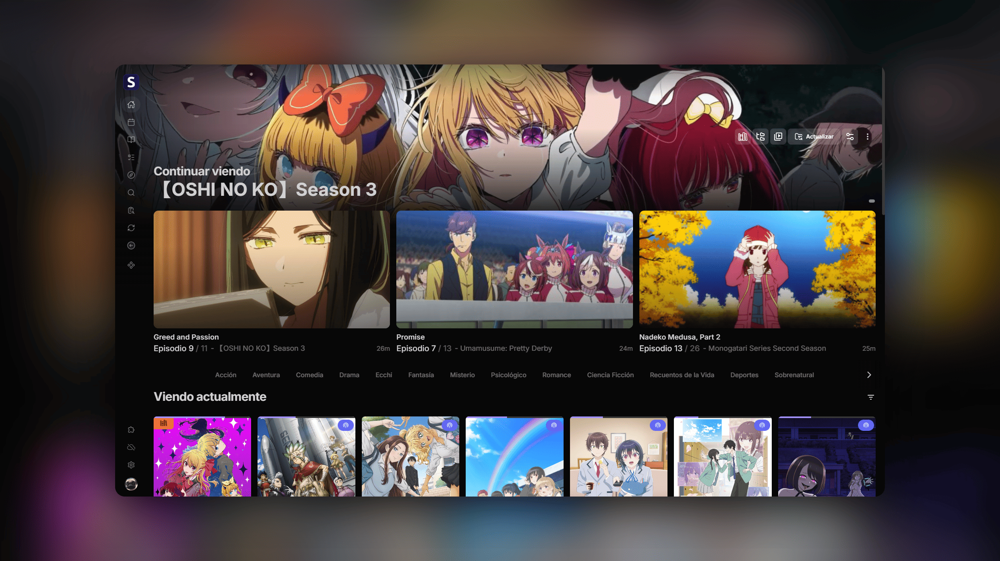

<h1 align="center"><b>Seanime Esp</b></h1>

  <b>Multilingual Fork of Seanime (with main focus on Spanish)</b> — Media server with web interface and desktop app for anime and manga

  <a href="./README.md">Español</a> |
  <a href="./README.pt.md">Português</a> |
  <strong>English</strong>

  <a href="https://github.com/5rahim/seanime">Original Project</a> |
  <a href="https://seanime.app/docs">Documentation</a> |
  <a href="https://github.com/Anthony00q/Seanime_Esp/releases">Latest release</a> |
  <a href="https://seanime.app/docs/policies">Copyright</a>

  
  

<h5 align="center">
If you like the project, leave a star on this and the <a href="https://github.com/5rahim/seanime">original repository</a>! ⭐️
</h5>

---

## What is this fork?

This is a **multilingual fork** of the [Seanime](https://github.com/5rahim/seanime) project created by [5rahim](https://github.com/5rahim).

**Goal:** I maintain this fork to use Seanime in Spanish and share the translations with anyone who finds them useful. It also includes English and Portuguese. I work on it on my own and try to bring in updates from the original project when I can.

**Branch structure:**
- `main` → pure mirror of upstream (no modifications)
- `traducciones` → working branch with translations

> [!IMPORTANT]
> Seanime does not provide, host or distribute media content. Users are responsible for obtaining content through legal means and complying with local laws. Extensions listed in the app are not affiliated with Seanime and may be removed if they violate copyright laws.

---

## Features

- **Cross-platform**: Web interface and desktop app for Windows, Linux and macOS, accessible from iOS and Android devices.
- **Seanime Denshi**: Desktop client with integrated video player based on libmpv (SSA/ASS subtitles, shaders and more).
- **AniList Integration**: Browse and manage your lists, discover anime and manga.
- **Custom Sources**: Support for adding anime and manga not on AniList.
- **Library Management**: Fast and smart scanning of local files without strict naming conventions or mandatory folder structures.
- **Torrent Integration**: Integrated torrent search engine via extensions and download support with qBittorrent, Transmission, TorBox, Real-Debrid, AllDebrid and Premiumize.
- **Torrent Streaming**: Stream torrents directly to the video player without waiting for downloads (supports BitTorrent, TorBox, Real-Debrid, AllDebrid and Premiumize).
- **Online Streaming**: Watch anime from online sources directly in the app via extensions.
- **Automatic Downloads**: Track and automatically download new episodes with customizable filters and advanced features (prioritization, scoring, delay, etc.).
- **Extension Catalog**: In-app repository to install and manage extensions for online streaming, manga sources and torrent providers.
- **Manga Reader**: Read chapters from your local library or via extensions with a unified interface.
- **Transcoding and Direct Play**: Stream your library to any device's web browser with on-the-fly transcoding or direct play.
- **External Player Support**: Seamless integration with MPV, VLC and MPC-HC on desktop.
- **Mobile Player Integration**: Open files and streams in mobile players (Outplayer, VLC, etc.) via intents or deep links.
- **Playlists**: Create and manage playlists for a continuous viewing experience.
- **Customizable Interface**: Customize the UI with color themes, background images and layout options.
- **Discord Rich Presence**: Automatically display your viewing activity.
- **Offline Mode**: Access your anime and manga library without internet connection.
- **Calendar**: Track upcoming releases and missed episodes.

---

## 📥 Getting Started (Installation)

1. Go to the [Releases](https://github.com/Anthony00q/Seanime_Esp/releases) section.
2. Download Seanime Denshi (desktop) or the server with web interface for your operating system and architecture.
3. Install the app or extract the archive and run it, depending on the download format.

---

## Architecture and Translation Progress

The original project has no native support for multiple languages (i18n), so a robust JSON-based translation architecture was built from scratch.

### 🌍 Current Status

The fork provides **broad interface coverage in Spanish, English and Portuguese (code `pt`, Brazilian variant)**. Select the language in Settings, then confirm the interface reload or Denshi restart to apply it. The modular architecture supports adding languages by following the contribution guide. Maintenance aims to improve wording and adapt changes from the original project, without guaranteeing an immediate update after every upstream release.

> [!WARNING]
> **Verification status**: The translation covers the vast majority of the interface, but **not every section has been exhaustively verified** to rule out regressions introduced during the translation process, and a few small strings may still be missing or in need of polish. If you find any errors, stray English text or broken behavior, please report it in the [Issues](https://github.com/Anthony00q/Seanime_Esp/issues) section.

**Technical System Details:**
- **Modular catalogs** — Thousands of JSON translation keys, with type validation and key parity across languages.
- **Server messages** — Toasts and HTTP errors are translated through frontend adapters, without introducing translations in Go. The fork also maintains its own updater adaptations.
- **Dates and Calendars** — Dynamic locale formatting and capitalization using `date-fns` and fork utilities.
- **Centralized text** — Translations live in catalogs; some text may still need translation, and custom extension content is not translated automatically.
- **New languages** — The [`Traducciones.md`](Traducciones.md) guide explains how to add and validate a language.

**Translated Areas and Components:**
Translations cover the main areas of the application, including:
- **Visual Core:** Navigation, Command Palette (Sea Command), Home Screen, Discovery and Setup Wizard.
- **Consumption:** Full Video Player (Subtitles, Chromecast, Anime4K), Interactive Manga Reader and Watch Parties (Nakama).
- **Management:** Advanced Settings, Local Library Scanner, Explorer, Automatic Downloader and Extension Store.
- **AniList & Metadata:** Dictionary of genres, formats, statuses, seasons and tags, Progress Tracking and Offline Lists.

---

## Tech Stack

| Layer | Technology |
|------|-----------|
| **Server** | [Go](https://go.dev/) |
| **Frontend** | [React](https://reactjs.org/), [Rsbuild/Rspack](https://rsbuild.rs/), [TanStack Router](https://tanstack.com/router) |
| **Desktop** | [Electron](https://www.electronjs.org/) |

---

## Development and Build

See the full guide at [DEVELOPMENT_AND_BUILD.md](DEVELOPMENT_AND_BUILD.md).

---

## Credits

This project is a fork of [Seanime](https://github.com/5rahim/seanime), created by [5rahim](https://github.com/5rahim).

If you like this project, consider **sponsoring the original creator**:

  

---

> [!NOTE]
> For copyright-related inquiries, contact the maintainer using the contact information on [THE WEBSITE](https://seanime.app/docs/policies).
